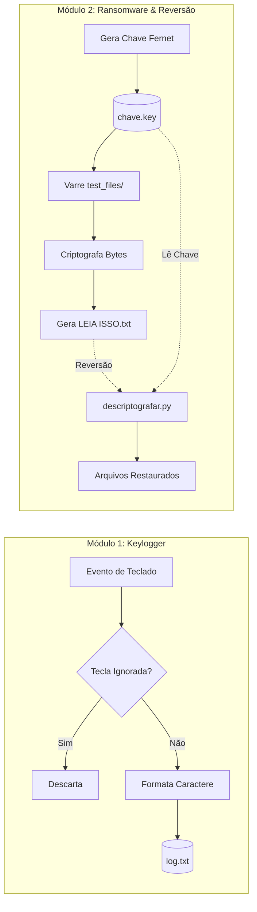

# 🛡️ Simulação de Análise de Ameaças: Keylogger e Ransomware


> ⚠️ **AVISO LEGAL (DISCLAIMER):** Este repositório foi desenvolvido **estritamente para fins educacionais e de estudo em Cibersegurança**. Os scripts aqui presentes foram projetados para execução exclusiva em ambientes controlados e isolados (máquinas virtuais ou diretórios de teste dedicados). O autor não se responsabiliza pelo uso indevido, não autorizado ou malicioso das técnicas demonstradas.

---

## 📋 Sobre o Projeto

Este projeto documenta uma atividade prática de Segurança da Informação voltada para a compreensão técnica do funcionamento interno de duas categorias clássicas de ameaças cibernéticas: **Keyloggers** e **Ransomwares**. 

O objetivo central da simulação é analisar como esses mecanismos interagem com o sistema operacional, eventos de entrada e sistema de arquivos, fornecendo base prática para o desenvolvimento de estratégias de detecção, mitigação e resposta a incidentes (**Blue Team**).

---

## 🗂️ Estrutura do Repositório

```text
├── keylogger/
│   ├── keylogger.py          # Script de captura de eventos de teclado
│   └── log.txt               # Arquivo gerado localmente com o registro das teclas
├── ransomware/
│   ├── ransonware.py         # Script de criptografia simétrica dos arquivos de teste
│   ├── descriptografar.py    # Script de reversão e recuperação dos arquivos
│   ├── chave.key             # Chave simétrica gerada em tempo de execução
│   ├── LEIA ISSO.txt         # Nota simulada de instrução gerada na execução
│   └── test_files/           # Diretório isolado alvo da simulação
└── README.md
```

---

## 🔄 Fluxo de Execução da Simulação



---

## ⚙️ Funcionamento Técnico dos Módulos

### 1. Módulo Keylogger (`keylogger.py`)
Demonstra o conceito de *Input Capture* (captura de entrada do usuário) por meio de monitoramento de eventos de teclado.
* **Biblioteca utilizada:** `pynput` (módulo `keyboard`).
* **Lógica de operação:**
  * Instancia um `keyboard.Listener` que escuta continuamente os eventos de pressionamento de teclas (`on_press`).
  * Filtra teclas modificadoras isoladas (`Shift`, `Ctrl`, `Alt`, `Caps Lock`, `Cmd`) através do conjunto `IGNORAR` para evitar ruído no log.
  * Trata teclas especiais de formatação (`Space`, `Enter`, `Tab`, `Backspace`, `Esc`) e grava o fluxo resultante no arquivo local `log.txt` com codificação `UTF-8`.

### 2. Módulo Ransomware (`ransonware.py` & `descriptografar.py`)
Demonstra o impacto da criptografia não autorizada sobre diretórios locais e o processo controlado de recuperação via chave simétrica.
* **Biblioteca utilizada:** `cryptography.fernet` (implementação de criptografia simétrica baseada em AES-128 em modo CBC com autenticação HMAC).
* **Fluxo de Criptografia (`ransonware.py`):**
  1. **Geração de Chave:** Cria uma chave criptográfica única via `Fernet.generate_key()` e a salva localmente em `chave.key`.
  2. **Varredura de Alvos:** Percorre recursivamente (`os.walk`) apenas o diretório isolado `test_files`, ignorando os próprios scripts e arquivos `.key`.
  3. **Criptografia:** Lê os bytes originais de cada arquivo encontrado, aplica `f.encrypt()` e sobrescreve o conteúdo original.
  4. **Notificação:** Gera o arquivo `LEIA ISSO.txt` simulando o aviso padrão exibido após o bloqueio dos dados.
* **Fluxo de Recuperação (`descriptografar.py`):**
  * Carrega a chave armazenada em `chave.key`, percorre novamente o diretório `test_files` e aplica `f.decrypt()` para restaurar a integridade original dos arquivos.

---

## 🚀 Como Executar em Ambiente Controlado

### Pré-requisitos
* Python 3.8 ou superior.
* Ambiente isolado (VM ou pasta de testes dedicada).

### 1. Instalação das Dependências
```bash
pip install pynput cryptography
```

### 2. Teste do Keylogger
```bash
python keylogger.py
```
> Pressione algumas teclas em qualquer janela e encerre o processo no terminal com `Ctrl + C`. Verifique o registro gerado em `log.txt`.

### 3. Teste do Ransomware e Recuperação
1. Crie uma pasta chamada `test_files` no mesmo diretório e adicione arquivos fictícios (ex.: `.txt`, `.csv` de exemplo).
2. Execute o script de criptografia:
   ```bash
   python ransonware.py
   ```
3. Confirme que os arquivos em `test_files` foram criptografados e que `chave.key` e `LEIA ISSO.txt` foram criados.
4. Execute o script de descriptografia para restaurar os dados originais:
   ```bash
   python descriptografar.py
   ```

---

## 🛡️ Medidas de Prevenção e Defesa (Blue Team)

A análise prática desses mecanismos evidencia os principais vetores monitorados por equipes de defesa e ferramentas de proteção de endpoint (EDR/AV):

* **Mitigação contra Keyloggers:**
  * Adoção de **Autenticação Multifator (MFA)** e gerenciadores de senhas com preenchimento automático (eliminando a digitação manual de credenciais).
  * Monitoramento de chamadas de API de baixo nível (como `SetWindowsHookEx` no Windows) por soluções de *Endpoint Detection and Response* (EDR).
* **Mitigação contra Ransomwares:**
  * **Backups imutáveis e offline (Regra 3-2-1):** Garante a continuidade operacional e restauração dos dados sem dependência de chaves externas.
  * **Princípio do Menor Privilégio (PoLP):** Restringe o escopo de leitura e escrita de processos executados no contexto do usuário.
  * **Monitoramento Comportamental e Isolamento Automático:** Soluções modernas identificam picos de entropia em arquivos e alterações em massa no sistema de arquivos, cortando a comunicação de rede do host imediatamente para conter a propagação lateral antes da resposta humana.

---

## 👨‍💻 Autor

Desenvolvido por **Gustavo Henrique Neves Godoi** ([@Gusta-2024](https://github.com/Gusta-2024)) como parte dos estudos práticos em Cibersegurança e Desenvolvimento de Software.
